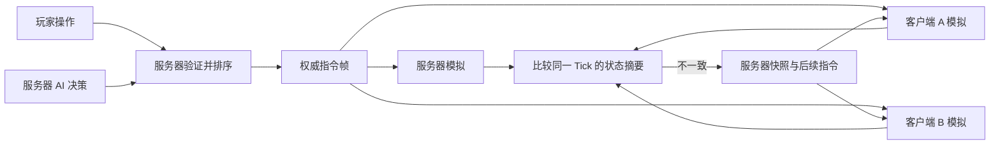

# ForgeFront 联机游戏设计

更新日期：2026-11-10。

状态：**首版已实现并部署至 aliyun。** 已完成共享指令模拟、权威服务器、单房间大厅、快照纠错、断线重连、跨引擎重放与六客户端限速验证。具体环境、测量范围和部署位置见第 14 节；不据此承诺任意规模、任意长局或多房间容量。

## 1. 目标与首版范围

采用“服务器统一裁定指令，各端运行同一套模拟，定期校验，失步后恢复服务器快照”的方案。服务器保存权威游戏状态，客户端本地计算战斗，减少持续传输全部士兵状态的需求。

先跑通两名真人，再扩展至最多六个阵营。真人与 AI 合计以六个阵营为首版规模目标，与当前六阵营素材及模拟能力对应。先验证一个房间，不把多房间容量视为已有保证。

保留现有游戏规则和操作：步枪与剑、配件装配、兵营中转、普通箭头与 Shift 分兵、抛射自动接近与展开、近战动画、两列 SVG 图卡。联网改造不顺带更改伤害、经济、地图规模或战斗动画。

首版处理对局初始化、操作同步、失步恢复和短时断线重连。服务器进程重启后的对局恢复、账号系统、匹配、旁观等不列入首版交付目标。

以下频率、缓冲和保留时长是建议初值，应依据实际测试调整，不是已经达到的性能指标。

## 2. 运行结构与职责



| 部分 | 职责 |
| --- | --- |
| 服务器 | 运行权威模拟，分配玩家席位，验证并排序指令，执行 AI 决策，保存摘要、快照和短期指令记录 |
| 客户端模拟 | 执行服务器确认的指令，使用共享规则推进世界，生成校验摘要，必要时恢复并重放 |
| 客户端表现 | 显示地图、单位、UI、特效；处理镜头、选择和箭头预览 |
| 共享模拟代码 | 地图数据、经济、生产、运输、移动、战斗、随机数、命令执行及状态编码 |

服务器需要计算整场游戏，而非仅转发消息。客户端报告的金币、伤害、位置和胜负不作为权威事实。

AI 决策只在服务器生成，随后变成与玩家操作相同的指令广播。客户端执行这些指令并计算战斗，不独立决定 AI 下一步的行为。当前实现已将 AI 移出 `stepWorld()`，由 `advanceAuthority()` 生成并执行一次指令；客户端只调用 `applyFrame()`。

首版使用 WebSocket；生产连接使用 WSS。WebSocket 基于 TCP，提供浏览器与服务器之间的双向通信，适合本项目首版的有序指令传输。[协议依据：RFC 6455](https://datatracker.ietf.org/doc/html/rfc6455)

## 3. 正常对局只持续同步操作指令

指令表达玩家想做什么，不表达客户端声称已经发生了什么。

| 操作 | 指令内容示例 |
| --- | --- |
| 建造 | 地块编号、建筑类型 |
| 升级 | 建筑所在的地块编号 |
| 工坊改产 | 工坊编号、装备类型 |
| 建立或删除产线 | 起点、终点，或线路编号 |
| 修改路线 | 线路编号、路径点 |
| 行军与攻击 | 具体士兵编号、目标地块、目标部队编号或落点 |
| Shift 分兵 | 经过确认的具体士兵编号；不让各端收到后再分别挑选“一半” |

选中框、镜头、菜单滚动和拖动中的箭头预览仍立即在本地响应。真实建造、扣钱、移动等状态变化，只在服务器指定的时间步执行。首版不对业务状态进行客户端提前预测，以减少撤销预测和回滚的复杂度。

服务器确认的一帧可以表达为：

```json
{
  "tick": 901,
  "commands": [
    {
      "player": 0,
      "seq": 58,
      "type": "armyOrder",
      "units": [101, 102, 103],
      "targetProvince": 12,
      "targetUnits": [201, 202]
    }
  ]
}
```

上例说明指令语义；实际结构见 `src/sim/commands.ts`：每项为 `{ player, seq, command }`，军令字段为 `units`、`province`、可选 `point` 与 `targets`。`tick` 是执行时间步，`seq` 是玩家指令序号，数组内顺序就是执行顺序。服务器广播的 `player` 来自连接对应的席位，不接受客户端自行声明的玩家身份。

实现保留所有通过格式与归属校验、实际交给规则执行器的尝试，包括规则拒绝或部分成功的命令；结果单独回复请求者。原因是原有多组军令可能部分成功，某些失败路径也会补齐队形数据，不能删掉尝试后让两端走不同代码。格式错误、越权、没有有效己方单位的请求直接拒绝，不进入指令帧。失败请求的序号仍被确认和去重。

服务器在执行时检查归属、存活状态、金币、装备兼容、目标、路线和坐标等业务条件。指令内失效的单位如何处理必须统一；首版建议保留属于该玩家且仍可执行的成员，并广播最终成员列表。最终没有可执行成员时拒绝该命令。

建造、设置产出、连线等有依赖关系的操作，按服务器规定的顺序逐条验证和执行。AI 规划阶段不能先修改一次世界，再由指令执行阶段修改第二次。

## 4. Tick、排序与客户端缓冲

继续使用现有的 **30 Hz 固定模拟频率**，每个 Tick 推进 `1/30` 秒。显示帧率可以不同，但模拟步长必须相同。

约定 `S[T]` 表示完成第 T 步之后的世界状态。第 T 步的处理顺序固定为：

1. 在 `S[T-1]` 上执行本帧权威指令，严格保留帧内顺序。
2. 调用一次共享模拟，推进生产、运输、移动、战斗与死亡处理，得到 `S[T]`。
3. 记录本帧、必要的摘要与快照，广播已完整确定的第 T 帧。

服务器为收到的操作分配后续尚未开始的 Tick，不允许客户端要求回填已经完成的时间步。服务器决定同一 Tick 内的唯一顺序；客户端不得重新按玩家编号或网络到达顺序排序。

没有操作时也发送完整的空指令帧，例如：

```json
{ "tick": 902, "commands": [] }
```

收到完整帧后，客户端才知道这一时间步可以推进。缺少帧不能被当成“没人操作”。

| 参数 | 建议初值 | 说明 |
| --- | --- | --- |
| 模拟频率 | 30 Hz | 与现有 `STEP` 一致 |
| 客户端缓冲 | 3–4 Tick | 约 100–133 ms，吸收网络抖动 |
| 状态校验 | 每 30 Tick | 比较同一时间步的状态摘要 |
| 服务器快照 | 每 30 Tick 保存一份 | 先保存在内存，不是每秒向所有客户端发送 |
| 恢复记录窗口 | 最近约 10 秒 | 快照和对应后续指令一起保留，长短由测量调整 |

客户端缓冲会增加操作延迟，最终延迟还包含网络往返和调度等待。镜头、选择与箭头预览无需等待网络。

网络晚到时，落后的客户端等待或补算，服务器与其他客户端继续运行。补算仍逐步执行 `1/30` 秒，不能用一个较大的步长跳过去。落后太多、浏览器从后台恢复或计算能力不足时，使用较新快照追赶。

渲染可以降低帧率或暂时停止绘制，游戏模拟不能擅自跳过已经确认的 Tick。

## 5. 初始化与一致性要求

服务器生成正式地图和初始状态，一次性发送给参与者。初始数据包括规则版本、地图数据或其标识、阵营与席位、出生点、初始单位、金币、Tick、随机状态和实体编号状态。

保留种子用于复现和日志，但首版不依赖不同浏览器各自生成地图后自然得到完全相同的坐标。图片、SVG、字体等静态资源提前加载，不混入持续的指令消息。

| 一致性条件 | 具体要求 |
| --- | --- |
| 同一规则版本 | 客户端与服务器的模拟代码和装备数值必须匹配；对局中不混用规则版本 |
| 同一初始状态 | 从服务器确认的同一份世界状态开始 |
| 同一指令序列 | 内容、执行 Tick 和帧内顺序一致 |
| 同一随机过程 | 战斗使用可复现随机数；保存当前随机状态，不只保存初始种子 |
| 同一处理顺序 | 明确单位行动、目标选择、命中、死亡和生产的先后顺序；避免依赖不受控的遍历顺序 |
| 同一数值规则 | 统一坐标、速度和计时器的计算及保存精度 |
| 同一状态恢复结果 | 缓存、共享引用与对象编号不能在恢复后改变业务结果 |

特效随机数不能消耗战斗随机数。服务器独立执行 AI 时，也不能因此额外消耗客户端没有消耗的战斗随机序列。

同一份 TypeScript 并不自动保证跨浏览器完全一致。JavaScript 的部分 `Math` 函数具有实现相关的精度，不同环境可能产生不同结果。[MDN：Math 的精度说明](https://developer.mozilla.org/en-US/docs/Web/JavaScript/Reference/Global_Objects/Math#description)

先用相同指令日志跨环境重放，定位真实差异；对影响结果的数值计算制定统一规则，必要时采用定点数或统一的数学实现。不能仅在生成摘要时截短小数，掩盖模拟内部已经产生的差异。

指令同步要求相同初始条件和输入得到相同结果；仅在同一环境运行两遍一致，不能作为跨平台一致性的证明。[确定性与指令同步原理](https://gafferongames.com/post/deterministic_lockstep/)

## 6. 校验摘要与快照保存什么

所有影响未来模拟、归属或正式战报的状态都必须纳入完整状态编码。快照需要足以恢复它们，校验摘要需要覆盖它们。

| 状态类别 | 必须覆盖的内容 |
| --- | --- |
| 全局 | Tick、当前随机状态、下一实体编号、阵营存活状态、胜负与战报统计 |
| 经济与建筑 | 金币、建筑类型与等级、血量、归属、生产与招募进度、装配进度、修复相关时间 |
| 士兵 | 编号、归属、位置、血量、武器与配件、装配资格、目标、冷却、压制、减速与冻结状态 |
| 行军与队形 | 路线、路径点、当前路段、位置、队形槽位和影响后续站位的数据 |
| 兵营与供给 | 连接、流量与运输时间、在途人员、分流游标等影响后续分配的状态 |
| 战斗 | 活跃人员、预备队、入场顺序与时间、锁定目标、炮兵命令及分组关系 |
| 弹体与区域 | 位置、速度、剩余寿命、阶段、命中过的目标、弹跳和分裂状态、持续伤害区域与脉冲计时 |

镜头、选中状态、菜单滚动、鼠标位置和不影响战斗的视觉反馈不参与游戏状态校验。纯视觉数据可以重建；恢复时不需要回放已经发生过的音效和动画。

真正可由完整状态无历史依赖地重建的缓存可以不保存。会影响结果的隐含缓存必须改成可重建的计算，或成为明确的状态。

状态编码使用固定字段格式和稳定编号。对象字段顺序需要统一；业务上有意义的列表顺序必须保留。不能通过随意排序所有列表消除差异，因为入场和行动顺序可能影响战斗。

可选择标准摘要算法对规范化后的状态编码生成摘要。摘要消息必须附带 Tick 和状态格式版本。服务器比较的是自己的 `S[T]` 与客户端的 `S[T]`，不能拿当前服务器状态与较早的客户端状态直接比较。

## 7. 失步恢复

服务器按校验间隔保留摘要。客户端计算相同 Tick 的摘要并上报，发现不同后请求恢复。

例如客户端第 900 步的摘要不匹配，而服务器已经运行到第 936 步，服务器可以选择最近的第 930 步快照，发送该快照和第 931–936 步的完整指令记录。

恢复流程：

1. 客户端停止继续推进错误的模拟，保留网络接收与当前画面。
2. 服务器选定完整快照，发送快照 Tick、状态格式和模拟版本、快照状态、已处理指令序号及对应后续指令。
3. 客户端替换业务世界，恢复随机状态、编号、计时器、队形和命令引用关系。
4. 客户端逐 Tick 重放后续权威指令并补算；期间不重复播放旧动画和音效，也不把重放指令重新发送为玩家操作。
5. 在同一 Tick 再次比较摘要。确认一致后重新建立显示缓冲并恢复正常运行。

替换业务状态不能通过平滑插值完成。需要平滑的只应是画面表现，权威血量、金币、目标、弹体和计时器必须恢复到正确值。

首版采用完整可变状态恢复，不先实现分地块或分单位的局部补丁。只改位置和血量可能留下错误的冷却、随机数或未清除的炮弹，造成后续再次失步。

完整快照不包含图片资源。不可变地图已确认一致时，快照可以引用相同地图标识，不重复发送全部地图几何。

恢复后仍持续失步时，保存对应的起始快照、指令日志、双方摘要与版本信息，定位第一次出现差异的 Tick。纠错是异常恢复手段；频繁重同步不能替代修复模拟差异。

## 8. 断线、重连与重复指令

玩家暂时断线时服务器继续模拟，已经下达的命令继续执行。首版不自动引入 AI 接管玩家的规则。

重连流程复用快照恢复：重新确认席位与版本，获取较新快照和后续帧，补算并重新校验后恢复操作。

每位玩家维护递增的指令 `seq`。服务器记录已处理序号及可用于确认的近期结果；“已处理”包括被拒绝的指令。重复收到相同指令不得重新扣费、建造、派兵或重新评估为一次新操作。

快照或重连响应告知客户端哪些指令已经处理。客户端只重发仍未确认的操作；服务器仍负责去重。玩家指令序号与游戏内部的实体编号分别管理。

断线时间超过旧日志窗口时，使用较新快照，不要求从开局重放全部历史。服务器进程本身丢失后如何续局，另行设计持久化方案，不在首版短时重连承诺内。

## 9. 协议最小组成

消息名称可在实施时调整，但职责需要保持清晰。

| 消息 | 方向 | 必要内容 |
| --- | --- | --- |
| 初始化 | 服务器 → 客户端 | 席位、版本、地图与初始快照、起始 Tick |
| 操作请求 | 客户端 → 服务器 | 指令序号、类型、具体单位与目标参数 |
| 操作结果 | 服务器 → 请求者 | 指令序号、接受或拒绝、执行 Tick 或失败原因 |
| 指令帧 | 服务器 → 所有客户端 | Tick、完整且有序的已接受指令；允许空帧 |
| 状态摘要 | 客户端 → 服务器 | Tick、编码版本、摘要 |
| 重同步请求 | 客户端 → 服务器 | 当前进度及请求原因，如失步、重连或严重落后 |
| 恢复包 | 服务器 → 客户端 | 权威快照、已处理序号、后续指令帧和校验信息 |

首版优先清晰、可记录与可重放的编码。是否改用更紧凑的二进制格式，由实际流量决定；不把自行实现传输协议作为首版前置工作。

## 10. 实施前识别的具体改造点

| 位置 | 当前情况 | 必要改造 |
| --- | --- | --- |
| [src/main.ts](../../src/main.ts) | UI 动作直接调用模拟函数，客户端按本地累计时间自行推进 | 增加提交指令与执行权威帧的入口；不得推进超过完整收到的帧 |
| [src/ui/GameUI.ts](../../src/ui/GameUI.ts) | 建造、升级、改产、行军等直接改变本地世界 | 改为提交意图；保留即时选择、镜头和箭头预览 |
| [src/sim/world.ts](../../src/sim/world.ts) | 已有统一 `stepWorld()`，内部调用 AI | 共享权威指令执行；把 AI 决策移出所有端共同推进的模拟步骤 |
| [src/ai/strategy.ts](../../src/ai/strategy.ts) | AI 直接调用建造、运输和作战操作 | 生成有序指令，经过服务器统一执行；不重复修改世界 |
| [src/sim/spatial.ts](../../src/sim/spatial.ts) | 队形位置保存在 `WeakMap`，扩容使用已有缓存 | 消除扩容的历史依赖，或明确保存和恢复必要队形状态 |
| [src/sim/attacks.ts](../../src/sim/attacks.ts)、[src/sim/world.ts](../../src/sim/world.ts) | 炮兵使用共享 `ArtilleryOrder` 对象作为分组键 | 改用稳定 `orderId` 及可恢复的命令表，或保证等价的共享引用恢复 |
| [src/sim/types.ts](../../src/sim/types.ts) | 包含固定时间步和主要世界状态类型 | 明确指令、完整可变状态、快照与版本契约，区分表现数据 |
| [tests/simulation.test.ts](../../tests/simulation.test.ts) | 已有同环境确定性与实体守恒检查 | 补充指令日志重放、快照往返和跨浏览器一致性验证 |

队形缓存问题已有只读复现：同一地块先请求 400 个站位、再请求 800 个，与新建状态后直接请求 800 个，部分后续站位不同。这是调用历史未完整包含在世界状态里的例子。

炮兵分组不能直接依赖普通 JSON 往返。多个士兵原本引用同一个命令对象，普通 JSON 读取后会成为多个独立对象，可能改变分组和队形结果。恢复必须保留逻辑上的共同命令身份。

上述问题已处理：队形只缓存基础站位，扩容从基础站位副本计算；炮兵命令新增稳定 `id`，JSON 恢复时按编号重建共享引用。`src/sim/math.ts` 使用统一的算术展开计算三角函数，距离统一计算；不通过摘要截断精度掩盖差异。已验证的运行环境见第 14 节，不代表所有架构均已测试。

## 11. 3 Mbps 的带宽预算

本节按**服务器总上行带宽 3 Mbps**估算，理论上约为 375,000 字节/秒。多个房间和客户端共享这个总量；AI 本身不是一个额外的客户端连接。

已有一次离线体积测量：80 地块、六个阵营、120 秒模拟，每 10 秒采样一次；采样中最多 536 名士兵、4 场战斗和 52 个弹体。假设把示例动态状态每秒广播 10 次给六个客户端，结果如下。

| 编码 | 最大采样快照字节数 | 估算总上行 |
| --- | ---: | ---: |
| 简化动态状态 JSON | 24,428 | 11.72544 Mbps |
| 同一数据 gzip 压缩 | 4,958 | 2.37984 Mbps |

计算方式为 `单份字节数 × 每秒发送次数 × 客户端数 × 8`。该示例省略了静态地图几何，动态字段也经过简化，不是完整恢复快照；未计入传输开销、重传、重连和资源下载，也不是实际联机压测或长局上限。[原始数据](../art-direction/2026-11-melee-starts/bandwidth-estimate.json)

因此，不能用这次测量承诺“3 Mbps 能稳定广播所有世界状态”。兵力增加、战斗增多或多房间并行都需要重新测量。

指令同步的常态流量包括操作、空指令帧、确认与摘要；完整状态主要用于初始化和异常恢复。大型选区仍可能产生较长的单位编号列表，因此也需要测量实际指令分布。

静态素材提前加载，正常对局尽量避免与大批资源下载争抢带宽。验收时分别统计正常指令流量、状态恢复流量与静态资源下载，不能只测空闲房间。

## 12. 实施阶段与验收标准

### 阶段一：离线指令化与重放

建立统一指令入口、状态编码与版本标识，拆出 AI 决策，处理队形缓存和炮兵命令身份。单机操作也通过同一命令执行路径调用原有规则。

验收：

- 相同初始状态和指令日志，在同环境重复运行后各校验 Tick 的摘要一致。
- 在 Node.js 和至少两个不同浏览器引擎中重放同一日志并比较摘要，记录具体版本。
- 在生产、中转、分兵、行军、炮击、持续伤害和死亡过程中的不同 Tick 保存与恢复，继续运行后与不中断的模拟一致。
- 现有单机规则、鼠标操作、图卡与战斗表现回归通过。

### 阶段二：两名真人联网

加入一个房间的权威服务器、连接与席位、操作验证、指令序号、完整指令帧和客户端缓冲。暂不引入业务状态预测。

验收：

- 两端建造、升级、连线、Shift 分兵、攻击和抛射，得到相同结果。
- 同 Tick 的多个操作顺序可重放；相互依赖的建造与连线不重复应用。
- 无效或重复指令不额外扣钱、不重复生产、不复制士兵，不能控制他人单位。
- 消息延迟或客户端掉帧时，不跳过逻辑帧；健康客户端不被另一客户端的短时卡顿拖停。

### 阶段三：校验、恢复与重连

加入周期摘要、服务器快照窗口、恢复包和重放流程。

验收：

- 主动改坏一端的金币、位置、血量、弹体或随机状态后，能够检测差异、恢复并重新匹配摘要。
- 恢复后的生产、运输、炮兵分组和队形继续正确运行，不只验证恢复瞬间的位置。
- 补算不重复播放旧效果，不重复执行已经确认的玩家指令。
- 断线后恢复席位与当前对局；未确认操作重发不会导致重复扣费或派兵。
- 超过旧日志窗口后可以从较新快照恢复，无需从开局回放。

### 阶段四：六阵营与带宽受限验证

扩展到六个阵营，包含真人与 AI 混合场景，在 3 Mbps 总上行限制下测量。

验收：

- 覆盖生产扩张、多场同时交战、抛射与持续伤害，检查状态一致性及实体守恒。
- 测量正常操作、突发多条指令、重连和状态恢复的平均与峰值上行。
- 在不同网络延迟、抖动、短时断线及浏览器后台恢复场景中，记录操作延迟、等待和追赶时间。
- 记录纠错频率；持续重复失步的原因必须解决，不能靠不断发送快照掩盖。
- 同步容量结论必须写明玩家数、地图规模、单位数量和网络条件；单房间通过不等于多房间通过。

开发中先运行能暴露问题的短场景；阶段完成后再做较长对局及跨环境验证，避免在每次小改动后重复执行昂贵的完整检查。

## 13. 当前进度

- [x] 同步架构方向已确认。
- [x] 已核对现有固定时间步、随机数与主要模拟入口。
- [x] 已识别队形缓存和炮兵共享命令的恢复问题。
- [x] 已保存一次离线带宽体积估算及其条件。
- [x] 指令入口、日志、状态编码与离线重放。
- [x] 跨浏览器一致性验证：Windows Node、Edge、Firefox，以及 aliyun Linux Node。
- [x] 权威服务器与两人联机，包括正式 HTTPS/WSS 入口验证。
- [x] 摘要、快照恢复与断线重连。
- [x] 六阵营、六个真实 WebSocket 客户端在共享 3 Mbps TCP 数据限速下验证。

## 14. 首版实现与部署记录（2026-11-10）

### 使用范围

- 一个共享大厅，首位在线玩家为房主；40/60/80 地块，0–5 名 AI，真人与 AI 合计 2–6 方。
- 对局开始后禁止新席位加入，已有玩家可重连；同一登录身份只占一个席位，另一页面接入会替换旧连接。
- 30 Hz 模拟，客户端保留 3 帧缓冲，每 30 步校验并在服务器保存快照，保留约 10 秒恢复窗口。落后超过 180 帧时请求新快照。
- 指令按玩家递增序号去重，保存近期结果；重连返回已处理序号，未确认操作重发也不会重复执行。
- 所有真人断线后继续运行最多 60 秒，然后回收房间。已结束且无人连接的房间立即回收。刷新同一标签页自动尝试恢复；服务器重启不会恢复旧局。
- 联机结束按钮提交本方投降，0 号玩家出局不会结束其他人的比赛。单机与试验场保留，原有图卡、箭头操作和战斗表现保留。
- 失步时保存最新一份诊断包，包含初始恢复快照、对应指令、双方摘要和版本。保存在服务器私有状态目录，不记录登录凭据。

### 验证结果

| 检查 | 结果与边界 |
| --- | --- |
| 自动测试 | 已验证 135 个用例：全量 134 项通过后，新增菜单用例并完成相关 UI 25 项检查；覆盖生产、战斗、鼠标操作、指令、快照、越权、重复请求、慢客户端及重连，生产构建通过 |
| 跨引擎重放 | 80 地块、六 AI、120 秒、345 条操作；混合近战/抛射及四种伤害配件，过程中两次重新编码恢复。Windows Node 24.16.0、Edge 157.0.4341.42、Firefox 153.0 与 aliyun Linux Node 22.23.4 的第 3600 步摘要均为 `83ff2b8486069c96` |
| 六客户端限速 | 六方、80 地块，约 93 秒真实 TCP/WebSocket 连接，共享 3 Mbps TCP 数据下行；下行附加 60–120 ms 抖动，上行附加 30–60 ms 延迟。正常阶段平均约 0.083 Mbps，最高一秒约 1.045 Mbps；不含 TLS/IP 开销和静态素材下载 |
| 操作延迟 | 上述限速场景记录 76 次操作，中位约 405 ms，P95 约 612 ms；包含人工网络延迟与客户端缓冲，不是无延迟局域网指标 |
| 恢复 | 模拟 4 秒/9 秒暂停计算、断线、主动修改一端金币；短暂停顿补算，较长停顿与状态破坏分别恢复一次，重连复用席位，最终六端摘要一致 |
| 正式服务器 | 两个临时玩家通过 HTTPS 页面和 WSS 完成建局、升级、93 步模拟和投降；两端最终摘要相同。未登录真实账号或写入私人存档 |

最初跨引擎测试在第 30 步复现原生 `atan2` 的末位差异；统一模拟数学实现后通过。上述结果是短场景验证，尚未覆盖移动端、数千单位长局或多个房间。未用计算机控制工具替用户试玩，鼠标行为通过原有处理器测试验证。

原始记录：[跨引擎回放](../verification/multiplayer-replay.json)、[六客户端限速](../verification/multiplayer-network.json)、[Linux 回放](../verification/aliyun-linux-replay.json)、[正式入口](../verification/aliyun-live.json)。复现脚本为 `scripts/verify-multiplayer.mjs`、`verify-network-load.mjs`、`verify-node-replay.mjs`；跨引擎脚本需要 Playwright 及对应测试浏览器，其余使用项目依赖即可。

### 服务器位置与维护

以下表格保留首版部署记录；当前发布位置与版本见[新手教程与边缘出生发布记录](../verification/tutorial-release.md)。

正式入口：[铸造前线](https://czhtbs.ykcryobs.cn/forgefront)，导航“其他”中紧跟 OpenFront。

| 项目 | 位置 |
| --- | --- |
| 服务 | `cs-forgefront.service`，独立 `cs-forgefront` 用户，512 MiB 内存上限、CPU 配额 100% |
| 当前运行代码 | `/usr/local/lib/cs-forgefront/current` → `releases/20261110-e067d738586dfbd1` |
| 规则/协议指纹 | `e067d738586dfbd1`，前端与服务器必须一致 |
| 后台连接 | `/run/cs-forgefront/game.sock`，只由 Nginx 代理，未开放新公网端口 |
| Nginx 入口 | `/etc/nginx/snippets/cs-forgefront.inc`；`/forgefront/play/socket` 提供 WSS，静态文件在 `/forgefront/play/` |
| 中转站页面 | `/opt/file_analyzer/forgefront_site.py`，`station.py` 增加导航、注册及临时玩家回跳 |
| 失步诊断 | `/var/lib/cs-forgefront/last-desync.json`，出现失步时写入 |
| 发布备份与清单 | `/opt/cs-station-upgrade/forgefront-20261110/` |

沿用中转站现有登录和签名临时玩家。Nginx 通过既有内部鉴权取得身份并覆盖玩家请求头；游戏服务器校验 Origin，不接受浏览器自报归属、金币、伤害或位置结果。没有新增数据库、Redis、注册账号或外部模型调用。

本次只平滑 reload 网站与 Nginx；原有主进程与容器保持。服务器重启本游戏会结束内存中的对局，维护前应先确认房间无人。

首次发布脚本 `scripts/deploy-aliyun.py` 会备份将改动的具体文件并校验替换位置，不直接覆盖未知的新版本。回退执行已发布包里的 `scripts/rollback-aliyun.py /opt/cs-station-upgrade/forgefront-20261110`；它先核对文件摘要，遇到后续修改会停止，避免覆盖其他工作的变更。回退保留发布包、备份和其他业务数据。
